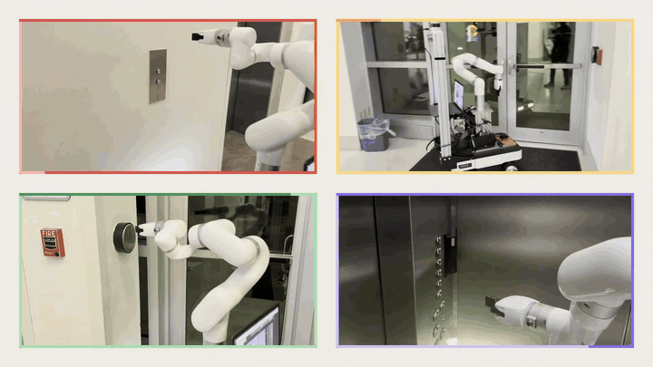
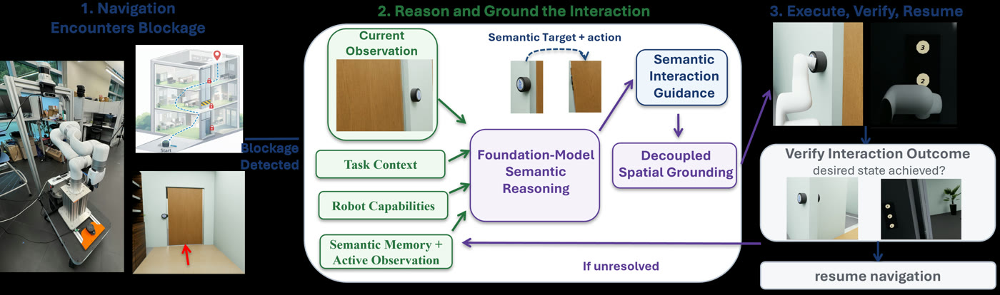
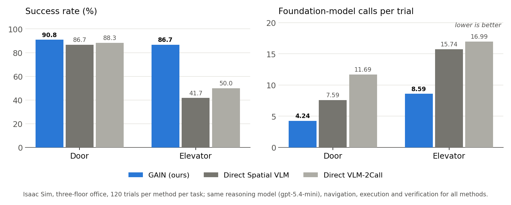
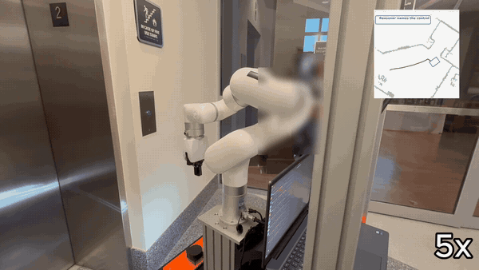
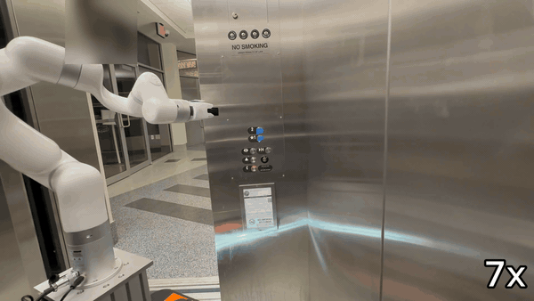
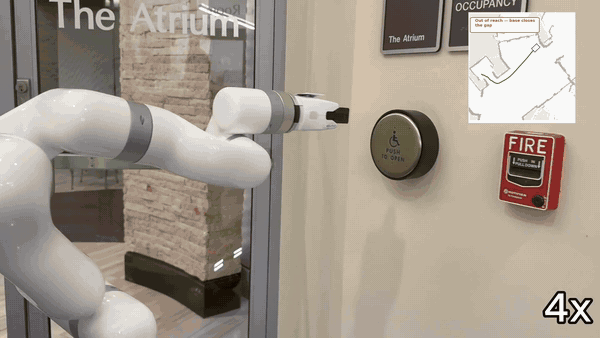
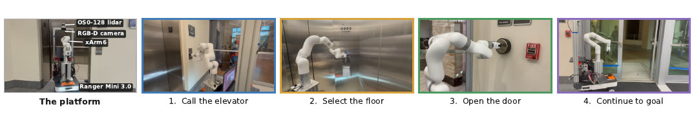

<h1 align="center">GAIN: Grounded Active Interactive Navigation<br>in State-Dependent Environments</h1>

<p align="center"><b>Physical robot stack</b></p>

<p align="center">
  <a href="https://github.com/AnikS22">Anik Sahai</a> and collaborators<br>
  SIMA Lab (Scalable Intelligence for Motion and Autonomy), Florida Atlantic University
</p>

<p align="center"><i>Paper under review (anonymized submission; full author list after the decision).</i></p>

<p align="center">
  <b>Paper:</b> under review, link after decision
  &nbsp;&middot;&nbsp;
  <a href="#real-world-deployment"><b>Video clips</b></a>
  &nbsp;&middot;&nbsp;
  <b>Simulation code:</b> <a href="https://github.com/AnikS22/unlocking-the-path">unlocking-the-path</a> (release pending)
  &nbsp;&middot;&nbsp;
  <b>Hardware code:</b> this repository
</p>

<p align="center">
  
  
  
</p>

<p align="center">
  
</p>
<p align="center"><sub>The physical robot (AgileX Ranger Mini 3.0 + uFactory xArm6) in a campus building:
calling the elevator, pressing door-release plates (one beside a fire alarm it must not touch) and
selecting the floor inside the car. Clips from the project video, faces blurred. These are
demonstrations, not counted trials.</sub></p>

**TL;DR.** A route can be geometrically valid and still blocked by a closed door or an elevator on
the wrong floor, and replanning cannot fix that. GAIN lets a mobile manipulator notice that progress
has stopped, asks a foundation model *what* must change (in words only, never pixels or
coordinates), hands that description to an open-vocabulary detector that decides *where*, and
presses the control. In simulation it beats direct VLM interaction on door and elevator tasks while
using roughly half the model calls. This repository is the hardware half: the ROS 2 stack, safety
layer and bring-up record for running the same pipeline on a real robot.

## Method

<p align="center">
  
</p>
<p align="center"><sub>(1) Nav2 reports a blockage. (2) The foundation model reasons over the current
observation, the task, the robot's capability list and a memory of what it has already tried, and
names the control in words; an open-vocabulary detector (Grounding DINO) localizes that description
and depth lifts it to a 3-D point. (3) The arm presses, the system checks whether the door or
elevator changed state, and navigation resumes; if nothing changed, the attempt goes back into
memory. Paper figure. The building illustration in panel 1 was generated with ChatGPT, as disclosed
in the paper.</sub></p>

The two stages exchange only a language description and a 3-D point. No component is trained; every
model is used off the shelf.

## Results (simulation)

All numbers are from the submitted manuscript. Isaac Sim, three-floor office, ROS 2 / Nav2, 120
trials per method per task. Every method uses the same reasoning model (`gpt-5.4-mini`), navigation,
execution and verification. *Direct Spatial VLM* asks the model for the action and its image
location in one call; *Direct VLM-2Call* asks for the action, then the location in a second call.

| Task | GAIN (ours) | Direct Spatial VLM | Direct VLM-2Call |
|---|---|---|---|
| Door: success | **109/120 (90.8%)** | 104/120 (86.7%) | 106/120 (88.3%) |
| Door: model calls per trial | **4.24** | 7.59 | 11.69 |
| Elevator: success | **104/120 (86.7%)** | 50/120 (41.7%) | 60/120 (50.0%) |
| Elevator: model calls per trial | **8.59** | 15.74 | 16.99 |

<p align="center">
  
</p>

- **Distractors.** 30 of the 120 door trials place a plausible wrong control (for example a fire
  alarm) next to the right one. GAIN succeeds on 24/30 (80.0%) of these against 85/90 (94.4%)
  without a distractor; both baselines reach 23/30.
- **Long horizon.** Missions that chain an elevator ride and a door (three interactions in order,
  no partial credit): GAIN with GPT-5.4 mini completes **85/100**.
- **Model sensitivity** (same 100 long-horizon missions, 23-call budget): GPT-5.4 mini 85/100
  (13.62 mean calls), Grok 4.3 60/100 (16.63), a Gemma 4-family model 18/100 (20.65). Gemma fails
  mostly at action selection; GPT and Grok fail mostly later, at target acquisition, grounding and
  physical execution.

## Real-world deployment

The same reason, ground, act, verify loop runs on the physical platform below. The real-robot
results are **qualitative**: the robot has called elevators, selected floors, ridden between floors
and opened accessible-entry doors in a campus building, but there are no counted real-robot trials
and no success rate to report. Every number in the section above is from simulation.

<table>
  <tr>
    <td align="center" width="33%"></td>
    <td align="center" width="33%"></td>
    <td align="center" width="33%"></td>
  </tr>
  <tr>
    <td align="center"><sub>Calling the elevator (5x)</sub></td>
    <td align="center"><sub>Selecting the floor in the car (7x)</sub></td>
    <td align="center"><sub>Accessible-entry plate, fire alarm not selected; door opens, robot drives through (4x)</sub></td>
  </tr>
</table>

<p align="center">
  
</p>
<p align="center"><sub>Platform: AgileX Ranger Mini 3.0 (4-wheel independent steering), uFactory xArm6,
Intel RealSense D435, Ouster OS0-128 (an RPLIDAR A1M8 was used in early bring-up), ROS 2 Jazzy on
Ubuntu 24.04.</sub></p>

The simulation stack lives in a separate repository
([unlocking-the-path](https://github.com/AnikS22/unlocking-the-path), release pending) and is never
modified by anything here; code is copied out of it, not edited in place. This repo is what happens
when that pipeline meets a real chassis.

---

## Hardware status — read this first

Every row is backed by a dated entry in [`EXPERIMENT_LOG.md`](EXPERIMENT_LOG.md), the commit
history or [`docs/PIPELINE_STATE.md`](docs/PIPELINE_STATE.md). "Demonstrated" means it happened on
the robot and was logged; none of it is a counted trial.

| stage | status | evidence |
|---|---|---|
| Navigate a recorded route leg | **working** | repeated arrivals within 0.15 m; on the 2026-09-10 building all five floor-5 Nav2 legs driven first attempt, two inside the lift car |
| Detect that the way is blocked and escalate | **working** | corridor veto fires, route hands off to the pipeline instead of steering around; camera OR lidar fusion (`safety/blockage_fusion.py`) |
| Ground the ADA plate in the image | **working** | score 0.581, 186×191 px, preferred over a fire alarm 20 cm away (2026-09-01b) |
| Refuse to press a fire alarm | **working** | the strongest forbidden hit (0.797) landed on the real alarm and was vetoed |
| Drive the base into arm reach | **working** | reach refused at 0.943 m from a 0.88 m arm, base crept in, re-grounded at 0.816 m (2026-09-07) |
| Press the ADA plate and drive through | **demonstrated** | first complete press-and-exit 2026-09-01b; again 2026-09-07 on floor 1 after a lift ride |
| Call the elevator | **demonstrated** | call button pressed twice in a row, operator confirmed the lift was called (2026-09-03); floor-5 DOWN button pressed with no hand correction (2026-09-11) |
| Select the floor inside the car | **demonstrated, not reliable** | contact correct, but one run pressed 5 instead of 1 in a dark car (fixed by strip division; root cause, under-exposure, not fixed) |
| Full floor 5 to floor 1 mission, one run | **not yet completed** | best run (2026-09-11) got through call, ride and in-car press, then correctly refused to drive at `FIND SELF` on floor 1 |

**History of the hard row.** Until 2026-09-01 the press had never landed: the last attempt missed by
~10 cm because the plate was grounded from 1.66 m, where a 12 cm plate subtends roughly 50 px and a
half-plate error is ~10 cm in the world. Two things closed it: re-grounding from the press pose with
the arm out of the camera's view (order LOOK, GROUND, SHOW, READY, REACH in `bringup/press_run.sh`),
and an empirical camera-to-arm offset in `calib/handeye.json` that improved two unrelated targets at
once. Both are documented in the log with the failures that preceded them.

---

## The engineering result worth reporting

Six separate failures during bring-up shared one signature: **the system worked as designed and
reported the problem somewhere nobody was listening.**

| what actually happened | what it looked like |
|---|---|
| Safety mux discarding commands (gate not satisfied) | "the path planner is broken" |
| No `arm_stowed` publisher on hardware — interlock never satisfiable | same |
| Chassis latched in RC mode; CAN commands silently dropped | same |
| Waypoints recorded in an odom frame that died with a power-cycle | robot drives somewhere random |
| `/scan_filtered` absent, so the obstacle veto failed **open** | robot drives into things |
| `ROS_DOMAIN_ID` unset — talking to the wrong graph | topics exist but nothing responds |

None of these were logic errors. Each was a silent-degradation path. The response was to make every
one of them **refuse loudly**: `bringup/health.py` is a single preflight that fails on any of the six,
and the safety mux is fail-closed by construction. This is the most transferable finding here — the
hard part of moving a working simulated policy onto hardware was not the policy.

Also measured, and worth knowing before trusting any number from this platform:

* **Odometry is accurate — drift is not the problem.** Measured 2026-08-29: lateral drift on a
  straight run **−0.000 m**, position drift on a spin **0.001 m**, and lidar scan-match against odom
  on a 27° spin **1.02**. Three runs returning to one recorded waypoint landed within a **14 cm**
  spread. (An earlier revision of this README claimed ~1 m of drift per loop. That figure was wrong
  and no measurement supports it; it is corrected here because it was being used to justify adding
  fiducial localization the data does not call for.)
* **The angular control path is the problem, not localization.** Command scaling is linear 0.94 but
  angular **0.59–0.80 and inconsistent** — the chassis under-rotates by up to 41% of what the stack
  believes it asked for. Odometry reports that honestly, so closing the loop should absorb it, and
  it did not: `Limits` carried a stall floor for linear velocity (`v_min`) and **none for angular**,
  while the 4WS wheels must physically re-steer before the body turns. Every heading correction the
  controller emitted was below the rate the chassis will execute, so a turn converged until it
  stalled ~0.167 rad short of tolerance and then held there with `vx = 0` — the observed livelock.
  Fixed 2026-08-30 (`w_min`); **not yet confirmed on hardware.**
* **Waypoints are odom-frame, so a chassis power-cycle silently invalidates them.** This is a frame
  *identity* problem, not a drift problem, and it is the honest case for absolute localization
  (AprilTag or lidar anchoring): waypoints that survive between sessions, not waypoints that fight
  drift. `safety/scan_anchor.py` is written and unit-tested and has **not** been run on the robot.
* **4WS mode-thrash**: re-issuing an angular command at 20 Hz re-steers all four wheels every cycle,
  so the body never commits to the turn. Angular commands must be held, not re-sent.
* **The lidar sits 0.318 m forward of `base_link`** at z = 0.379 m — confirmed independently by the
  geometry of the robot's own self-hits in the scan.

---

## Architecture

```
              ┌─────────────────────────────────────────────┐
   mission ─▶ │ run_trial.py    one trial: legs + FSM        │
   (yaml)     └──────┬──────────────────────────────┬────────┘
                     │ leg blocked?                 │ action step
                     ▼                              ▼
          ┌──────────────────────┐      ┌────────────────────────────┐
          │ escalation.py        │      │ VLM reasoner  (picks TOOL) │
          │ geometry ran out —   │─────▶│   "look left" / "press"    │
          │ ask the pipeline     │      └─────────────┬──────────────┘
          └──────────────────────┘                    │ tool, never coordinates
                                                      ▼
                                        ┌────────────────────────────┐
                                        │ GDINO grounder (LOCALIZES) │
                                        │  + press_veto: not a fire  │
                                        │    alarm                   │
                                        └─────────────┬──────────────┘
                                                      ▼
                                        ┌────────────────────────────┐
                                        │ reach_envelope → base moves│
                                        │ into reach → xArm6 presses │
                                        └────────────────────────────┘

   every motion command, from every source, passes through:
          ┌──────────────────────────────────────────────────────────┐
          │ twist_mux_node.py — the ONLY publisher of /cmd_vel       │
          │ fail-closed gates: estop · arm_stowed · enable · override │
          └──────────────────────────────────────────────────────────┘
```

Two design commitments are load-bearing:

1. **The reasoner never emits coordinates.** It selects from a fixed tool vocabulary; a separate
   open-vocabulary detector does all localization. A VLM that hallucinates a pixel is a bug you cannot
   see; a VLM that picks the wrong tool is one you can.
2. **Motion is fail-closed.** `twist_mux_node` is the single `/cmd_vel` publisher and every gate must
   be *affirmatively* satisfied. A missing publisher stops the robot; it does not free it.

---

## Repository layout

```
safety/        pure decision logic — no ROS imports, so it is testable headlessly
               arbiter · twist_mux_node · route_plan · waypoint_drive · reach_envelope
               press_veto · escalation · look_policy · local_avoid · scan_anchor
               lidar_lift · scan_filter · mux_watch · waypoint_frame · teleop_guard
bringup/       the executable layer: ROS nodes, run scripts, one-shot diagnostics
               health.py       preflight — fails on any of the six silent-degradation paths
               run_trial.py    one trial · run_campaign.py  N trials, with drift budget
               session.sh      the front door: up · map · nav · campaign · down
               nav2_goto.py    drive one leg on the saved map · map_persist.sh  the map script
               waypoints.py    record / list / anchor odom-frame waypoints
               press_run.sh    READY → LOOK → GROUND → REACH
               reach_control.sh  ground, position, re-ground, press
config/        routes.yaml (missions) · safety.yaml (gates, speed and slew ceilings) · slam_os0.yaml
nav2_bringup/  Nav2 config, ported for real hardware (use_sim_time:=false, spin removed)
docs/          runbooks — start with MORNING.md, then MAPPING.md and NAV2.md
               FLOOR1_REMAP.md  the current job, in the order it must happen
               TESTING.md       what each test file guards, and how to triage a red one
tests/         all headless: no ROS, no GPU, no hardware. 478 passed / 29 skipped / 2 xfailed
               as of 2026-09-05; see docs/TESTING.md for what each file guards
patches/       our diffs against upstream drivers, applied by setup_workspace.sh
maps/          site maps (see maps/README.md) · archive/ retired scripts, see archive/README.md
media/         README figures and clips (from the paper and the blurred project video)
ros2_ws/       GITIGNORED — rebuilt from pinned upstream commits by setup_workspace.sh
```

`safety/` holds no ROS imports on purpose. Every rule that can stop the robot is a pure function with
a test, and the ROS nodes are thin shells over it. That is why the suite runs in 22 seconds on a
laptop with nothing plugged in.

---

## Running it

```bash
git clone https://github.com/AnikS22/utp_robot ~/utp_robot && cd ~/utp_robot
bash bringup/setup_workspace.sh     # clones + patches + builds drivers (no sudo, ~30 s)
source bringup/env.sh
```

Tests need nothing but Python:

```bash
python3 -m pytest tests/ -q -p no:launch_testing     # 478 passed, 29 skipped, 2 xfailed
```

`-p no:launch_testing` disables a ROS-bundled pytest plugin that is incompatible with the pytest
version this suite is written against and otherwise stops pytest from starting at all. See
`docs/TESTING.md` for what each file guards and the triage rule for a failing test.

### Bring-up: one command

Read [BOOTUP.md](BOOTUP.md) and [the startup runbook](docs/STARTUP.md).

```bash
bash bringup/inputs.sh up       # sensors, camera, arm/safety; no localization
bash bringup/inputs.sh check    # read-only audit and saved report
bash bringup/bringup_all.sh --mode map
# Navigation: supply the robot's actual pose in the selected map.
SEED_POSE='X,Y,YAW' bash bringup/bringup_all.sh --mode nav --map floor1
```

`bringup_all.sh` probes the required components, retains healthy processes and waits for
new components to produce data. See the runbook for mode selection, localization seeds,
map saving and shutdown. The older scripts remain for historical workflows.

It ends with a table of every component and, underneath it, a `WHY` block that names the actual
cause rather than the layer the symptom appeared in — "there is no `odom->base_link`, so slam cannot
publish `map->odom`", not "localization is wrong".

`MAP_NAME=elevator` (the default) selects the map to localize into. Floor 2 is `MAP_NAME=floor2`.
On the first building, floor 1 was re-mapped into a single `floor1` map covering both the lift lobby and the ADA
door — `config/floors.yaml` already names it, so `floor_swap.py --check` fails on purpose until
the drive is done. Procedure and order: **[docs/FLOOR1_REMAP.md](docs/FLOOR1_REMAP.md)**.

### Nine things that stop a bring-up

Every one of these cost real time on 2026-09-04 because nothing checked for it. The right-hand
column is what `stack.sh` now does about it.

| | what goes wrong | how it presents | `stack.sh` |
|---|---|---|---|
| 1 | **Stale Ouster driver** holding the UDP socket across a robot power cycle | `ros2 node list` shows `/ouster/os_driver`; `/ouster/points` is 0.00 Hz | detects by rate, kills, restarts `lidar3d.sh` |
| 2 | **The scan chain is not restarted with the lidar** — `lidar3d.sh` starts only the driver + static TF | lidar healthy, `/scan_filtered` and `/scan` still dead | probes both separately, restarts `pointcloud_to_laserscan` and `scan_relay.py` |
| 3 | **Chassis driver absent**, so there is no `/odom` at all | "localization is wrong in RViz" — three layers from the cause: no `/odom` → no `odom->base_link` → slam_toolbox cannot publish `map->odom` | probes `/odom` + the TF, restarts, and the `WHY` block names the chassis |
| 4 | **`ranger_bringup` not found** when launched from a bare `source /opt/ros/jazzy/setup.bash` — the overlay lives in `ros2_ws/install` | a misleading "package not found", one wasted launch cycle | sources `bringup/env.sh` itself; **always** do the same |
| 5 | **slam_toolbox comes up UNCONFIGURED** — it is a lifecycle node | `/map` never publishes and everything downstream looks broken | runs `ros2 lifecycle set /slam_toolbox configure`, then `activate` |
| 6 | **Two Nav2 stacks, neither activated.** Repeated `ros2 launch` calls leave two `lifecycle_manager` instances contending for the same nodes, and the activation never completes | every goal comes back **"rejected in 0.0s"** and RViz shows an empty world. Silent three ways at once: `ros2 node list` shows a healthy-looking Nav2; `ros2 action list` **does** show `/navigate_to_pose`, because the action server is advertised *before* activation; and the empty RViz reads as an RViz config problem. `ros2 lifecycle get /bt_navigator` → `inactive [2]` is the only check that sees it | counts `bt_navigator`/`planner_server` processes and tears **all** of them down before starting one, then requires `bt_navigator`, `planner_server` and `controller_server` to report **active** — not merely present |
| 7 | **No initial pose.** `config/slam_os0.yaml` `map_start_pose` is an *atrium* coordinate | map loads, no `map->odom`, robot is nowhere | detects and says so — **you** set it: RViz 2D Pose Estimate (localization mode only) or `python3 bringup/relocalise.py` |
| 8 | **CAN authority.** `can0` can be UP while the chassis is still in RC mode, discarding every computer command *silently* | odom and the mux both look perfectly healthy; the robot does not move | detects via `chassis_mode.py` and says so — **you** flip SWB up and run `python3 bringup/claim_can.py` |
| 9 | **RViz shows nothing.** `os0_nav.rviz` displays only the Nav2 costmaps — no `/map`, no `/waypoint_markers` — so before Nav2 starts it renders an empty world | "the map did not load" | not touched. Use `nav2_bringup/elevator.rviz`, and set **Color Transformer: FlatColor** on the LaserScan — RViz defaults to colour-by-intensity and draws everything white |

**Read the goal status word — the three are not synonyms.** `rejected` means the action server would
not accept the goal at all, which is almost always lifecycle or config (row 6), not the world;
`aborted` means it tried and failed; `blocked` in `bringup/nav2_goto.py` means Nav2 `STATUS_ABORTED`
specifically, and is the verdict that starts reason → ground → press.

**When a component looks wrong, check for duplicates before starting another one.** Row 6 is one of
three instances of the same shape on 2026-09-04: two Nav2 stacks, two RealSense drivers racing for
the USB device (the loser logs "No RealSense devices were found"), and two `waypoint_markers`
publishers on one topic. A second `ros2 launch` is not a harmless retry.

Two more that read as errors and are not: `sudo ip link set can0 up` returning **"device busy"** means
can0 is *already* up; and touching the RC transmitter sticks reclaims RC authority at any moment,
including mid-run.

The same four layers by hand, if you want each driver's output in its own terminal:

```bash
ros2 launch ranger_bringup ranger_mini_v3.launch.py   # 1  chassis
bash bringup/lidar3d.sh                               # 2  OS0 -> /ouster/points -> /scan_filtered
bash bringup/camera.sh                                # 3  camera
bash bringup/safety.sh                                # 4  safety mux + arm gate
```

Then, **before anything moves**:

```bash
python3 bringup/health.py
```

It must report chassis mode `CAN` (not `RC`), `arm_stowed` at 100%, and exactly one publisher each on
`/odom`, `/scan`, `/cmd_vel`. It refuses rather than warns.

Record a route and run it (waypoints are odom-frame — record and run in one session):

```bash
python3 bringup/waypoints.py record start  --frame map
#  ... drive to the door ...
python3 bringup/waypoints.py record door   --frame map
#  ... drive to the press pose ...
python3 bringup/waypoints.py record button --frame map
python3 bringup/nav2_goto.py door --go     # one leg, on the saved map
bash bringup/session.sh campaign 50        # the full run
```

`--go` is required for any motion at all; without it every script prints what it would do. Full procedure,
including what to watch and when to stop it, is in **[docs/MORNING.md](docs/MORNING.md)**.

`ROS_DOMAIN_ID` is **9 for hardware, 42 for simulation**, set by `bringup/env.sh`. This separation is
not cosmetic — it is what keeps a simulated route from ever reaching a real chassis.

---

## Small changes that turn into big errors

The bring-up table above is faults that announce themselves. These are worse: **things that report
success while proving nothing.** A wrong value gets caught. A check that cannot fail gets believed.

### Checks that pass while proving nothing

| the check | why it proves nothing | what it produced |
|---|---|---|
| `grep -q active` on a lifecycle state | the string **`inactive` contains `active`** | a green Nav2 in the component table while every goal came back `rejected in 0.0s` |
| **existence** probe (`ros2 node list`, `ros2 topic list`) | a process being alive is not data flowing | the Ouster driver up and publishing **0.00 Hz** — a stale process holding the UDP socket across a power cycle. Surfaced three layers away as "localization is wrong in RViz" |
| `can_transform(..., timeout=0)` | a just-started node has not finished **DDS discovery**, and a latched `/tf_static` arrives only after it does — so timeout 0 times your own subscription setup, not the transform | `base_link -> os_lidar` reported absent while `tf2_echo` resolved it instantly in the next terminal. Hours into a TF tree that was fine. **Fixed by giving it 12 s** |

`ros2 topic hz` is also not a rate probe: it has reported 1.7 Hz and 10.0 Hz for the same topic
minutes apart against a repeatable 6.4 Hz. Measure with a counting subscriber — `stack.sh`'s
`rate()` is the reference. The shape underneath all of it: **ask the question that can come back
"no".** A check that cannot fail is worse than no check, because it ends the investigation.

### A config file is code that nothing compiles

`config/floors.yaml` named map `elevator_f2` and waypoints `call_button_f2` / `car_panel_f2`. None
of those existed — the map on disk is `maps/floor2.*` and the waypoints are **`f2_`-prefixed**, not
`_f2`-suffixed. The entry had been written from the naming convention in the file's own header
rather than from what was actually recorded. Uncaught, it would have surfaced as
`floor_swap.py --to 2 --go` failing to find its seed pose **with the robot already inside the lift
car**, doors about to close.

`python3 bringup/floor_swap.py --check` caught it, and is pure offline Python — no ROS, no robot.
Run it after every edit to that file.

### A seed pose is a claim about the world, and in a lift car it is the only one

The floor swap seeded `map_start_pose` from `car_facing_out` unconditionally. The robot actually
rides parked at `car_panel` — **0.48 m and 116° away**. That error is not self-correcting: a closed
car's scan is four blank walls about a metre away, so there is nothing in it to pull the estimate
back. The matcher converges confidently onto whatever seed it was given, and the mistake only
becomes visible once the doors open and the robot drives. `--seed-role` now names where the robot
physically is.

### A `.pgm`/`.yaml` map with no `.posegraph` looks exactly like a map

`slam_toolbox` `mode: localization` relocalizes by deserializing the `.posegraph`. Handed only a
grid it does **not** error — it starts a new, empty graph at the robot's feet, publishes `/map`,
and reports `active`. `maps/atrium.*` is such a map, and it is the one the ADA-button waypoints
were recorded in, so those waypoints name coordinates in a frame that no longer exists.

Two such maps also **cannot be merged**: a pose graph is a chain of scan matches from one
continuous drive, and there was never a drive linking the lift lobby to the ADA door. One
continuous drive is the only fix — that is `floor1`, and
**[docs/FLOOR1_REMAP.md](docs/FLOOR1_REMAP.md)** is the procedure.

### slam_toolbox keeps its LAUNCH-TIME parameters

Editing `config/slam_os0.yaml` after the node is running changes nothing. The robot stayed
mis-localized and it was reported as fixed. Restart the node, then verify with `ros2 param get`.

### A mapping drive lives only in RAM until it is serialized

`slam_toolbox` holds the pose graph in memory and serializes only on request. On 2026-09-05 a
floor-1 mapping drive died with its session: no partial map, nothing on disk, nothing to salvage,
the walk repeated from scratch. Nothing was recording, so there was never a second chance to have.

```bash
bash bringup/map_insurance.sh start floor1     # BEFORE the drive, in its own terminal
```

It records `/scan /scan_nav /tf /tf_static /odom` — what slam_toolbox actually consumes, ~1–2 MB
per minute — so the drive can be replayed and rebuilt offline. `ros2 bag record -a` is not an
option here: `/ouster/points` is 3.1 MB per cloud and the one such bag in `runs/` is 3.4 GB.

### Known trap: `session.sh` step 0 pings the xArm for every session type

`bringup/session.sh:66-68` pings `192.168.1.119` (lidar), **`192.168.1.221` (xArm)** and
`192.168.1.1` (router) and dies on the first unreachable one — before it looks at the command word.
So a **nav-only or mapping-only** run is blocked whenever the arm is powered off, which is the
normal state for a mapping drive. It presents as `192.168.1.221 unreachable`, which reads as a
fault on the one cable that also carries the lidar.

**Proposed, not applied:** keep `.119` and `.1` fatal for every session, demote `.221` to a warning
for `map` and `nav`, and leave it fatal for `campaign` and anything that presses. Not applied here
because `session.sh` is live; it belongs to whoever is next at the console.

---

## Known-open

1. **One complete multi-floor run.** The press now lands (see the status table); what is missing is
   a single run from floor 5 to the floor-1 goal. The best attempt (2026-09-11) stopped at
   `FIND SELF` on floor 1 because the global search never got 3 of 5 searches to agree. Open
   problems for that run, including the controller choosing its own IK branch, are in
   [docs/PIPELINE_STATE.md](docs/PIPELINE_STATE.md).
2. **Lidar re-anchoring** (`waypoints.py anchor` / `relocalize`). Written, unit-tested, never run on
   the robot. It is what removes the re-record-before-every-run tax — which is caused by the odom
   frame not surviving a power-cycle, not by drift within a run.
3. **Isaac depth is dead on this laptop** — the depth topic publishes 100% `inf` on every frame; the
   Isaac log names it (`Illegal cycle connection … WriterSyncGate … ignored`, an SDG graph problem).
   Fixing it would mean editing the simulation repo, which project policy forbids. Consequence: the
   sim can validate navigation and the state machine, but **cannot** validate grounding. This is why
   `safety/lidar_lift.py` exists — it lifts a 2D box to 3D from lidar when depth has nothing, which
   also covers glass doors, where depth genuinely fails on hardware too.
4. **Elevator interaction is demonstrated, not reliable.** The lift has been called and ridden
   (2026-09-03, 2026-09-07), but two wrong-button presses are logged: UP instead of DOWN on a
   two-button plate, and 5 instead of 1 in a dark car. Both are fixed by spatial picking in
   `bringup/detect_frame.py`; the car's under-exposure, the root cause of the second, is not.
5. **Floor 1 of the first building** (historical; the current site is the 2026-09-10 building,
   floors `5` and `1L`). It was two maps — `elevator` (lift lobby, relocalizable) and
   `atrium` (ADA door, `.pgm`/`.yaml` only, so not relocalizable and not mergeable). One
   continuous drive covering both is being recorded as `floor1`. `config/floors.yaml` already
   names it and its five `f1_` waypoints, so `floor_swap.py --check` fails until the drive is
   done — deliberately. `bringup/elevator_route.sh` still drives the old unsuffixed names and
   will need updating after. See [docs/FLOOR1_REMAP.md](docs/FLOOR1_REMAP.md). The `floor1` map
   was saved on 2026-09-05 (four files verified non-empty; loop closure not independently checked).

---

## Reading order for a reviewer

1. `EXPERIMENT_LOG.md` — dated findings, including everything that failed.
2. `docs/PIPELINE_STATE.md` — state as of 2026-09-11 and the one command for the multi-floor run;
   `docs/MORNING.md` — the earlier runbook.
3. `safety/route_plan.py` and `safety/reach_envelope.py` — the mission and geometry rules, with the
   constants ported from the simulator and the reasoning for each.
4. `tests/test_press_veto.py` — the safety case that matters most: never press a fire alarm.

---

## Limitations

- **Real-robot evidence is qualitative.** The physical robot has operated door-release plates, the
  elevator call plate and the in-car floor panel, but there are no counted real-robot trials. All
  success rates in this README are from simulation.
- **One platform, one site at a time.** Calibration offsets, per-target standoffs and the button
  counts in `config/floors.yaml` are measured for this robot in these buildings and will not
  transfer without re-measurement.
- **Not hands-off.** Runs are supervised with the E-stop in hand; the arm has no force sensing, and
  as of the 2026-09-01 log `requires_enable` was off for supervised runs, which `run_campaign.py`
  refuses to run with.
- **Glass is invisible to the lidar** and dark elevator cars degrade the camera; both are handled by
  fusion and fallbacks, not solved.
- **The simulator cannot validate grounding on this laptop** (Isaac depth is dead, Known-open 3), so
  sim-to-real here means navigation and the state machine, not perception.

## Citation

The submission is anonymized for review; the full author list will be added after the decision.

```bibtex
@misc{sahai2026gain,
  title  = {{GAIN}: Grounded Active Interactive Navigation in State-Dependent Environments},
  author = {Sahai, Anik and others},
  year   = {2026},
  note   = {Under review}
}
```

## Acknowledgments

This work was done in the SIMA Lab (Scalable Intelligence for Motion and Autonomy) at Florida
Atlantic University, advised by Dr. Minghan Wei. The simulation pipeline this stack ports from was
developed in [unlocking-the-path](https://github.com/AnikS22/unlocking-the-path); see that
repository for its contributors.

## License

No license has been chosen yet; all rights are reserved until one is.
